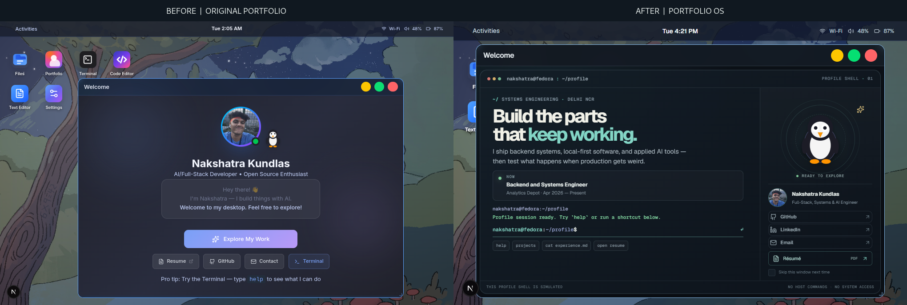

# Project Next OS

A Fedora-inspired portfolio desktop for Nakshatra Kundlas, with a cursor-reactive Tux, an interactive profile shell, and real project screenshots.

**Live portfolio:** [portfolio-next-os.vercel.app](https://portfolio-next-os.vercel.app) · **Source:** [Zburgers/portfolio-next-os](https://github.com/Zburgers/portfolio-next-os)

## Preview

The comparison shows the original Tux welcome and the refreshed terminal profile at the same desktop viewport.



## What changed

- The profile opens in a compact shell: type `help`, `projects`, `cat experience.md`, or `open resume`.
- Tux follows the pointer and reacts to successful commands, errors, and the safe destructive-command easter egg.
- Work cards use local screenshots from public repositories. The résumé-backed Experience and Toolbox sections share the updated profile data.
- The August 2026 résumé is served directly at `/resume.pdf`.
- Opening an app again focuses its existing window; source and text editors can still open separate documents.
- The mobile version keeps the work images, current role, experience, and contact links in a scroll-first layout.

The profile shell is simulated. It cannot inspect the visitor's computer or run host commands; `sudo` is disabled and `rm -rf /` only triggers a Tux reaction. The GitHub browser reads public repository data and renders it as text.

## Project screenshots

- SandLabX: [`docs/screenshots/08-canvas-network-topology.png`](https://github.com/Zburgers/SandlabsX/blob/main/docs/screenshots/08-canvas-network-topology.png)
- VibeVoice: [`docs/assets/screenshots/vibevoice-control.png`](https://github.com/Zburgers/vibevoice/blob/master/docs/assets/screenshots/vibevoice-control.png)
- FlashRL: [`reports/demo/median.gif`](https://github.com/Zburgers/FlashRL/blob/master/reports/demo/median.gif), resized and optimized for the portfolio
- mdview: [`docs/Demo.png`](https://github.com/Zburgers/mdview/blob/main/docs/Demo.png)
- CB Connect: public landing page screenshot from [cb.nakshatraneuratech.dev](https://cb.nakshatraneuratech.dev)

## Run locally

Requirements: Node.js 18 or newer and npm.

```bash
npm ci
npm run dev -- -p 3100
```

Open [http://localhost:3100](http://localhost:3100). To make local production output, run `npm run build` and then `npm start -- -p 3100`.

The GitHub browser works with public repositories without a token. GitHub may rate-limit unauthenticated requests; set `GITHUB_TOKEN` in the deployment environment for a higher API limit. Never commit the token.

## Stack

Next.js 15 App Router, React 19, TypeScript, Tailwind CSS 4, Framer Motion, and Lucide icons.

## Project layout

- `src/app` — application entry, styles, metadata, and GitHub API routes
- `src/components/Welcome` — profile shell and reactive Tux
- `src/components/apps` — portfolio and desktop apps
- `src/components/boot/MobilePortfolio.tsx` — small-screen portfolio
- `src/context/DesktopContext.tsx` — desktop windows and appearance state
- `src/lib/profile.ts` and `src/lib/projects.ts` — résumé-backed content
